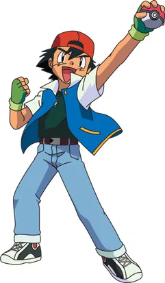

<!-- Upload your Ash Ketchum image to this repo at assets/ash-ketchum.png (or paste any direct image URL in src below) -->

&nbsp;&nbsp;&nbsp;

  

---

### 📍 About Me

I'm a software developer who learns by building. I enjoy taking an idea from a rough sketch to something that actually runs: designing the logic, writing the code, and polishing it until it's ready to show off. My projects range from an AI-powered child-safety platform to a personal portfolio site and SQL-backed data tools, and every one of them taught me something new about writing better software.

Like a trainer raising a Charmander, I'm focused on steady growth: one project, one bug fix and one level at a time.

**Currently focused on:** full-stack development with TypeScript, working with databases (SQL and PostgreSQL), and strengthening DSA and system design for SDE roles.

| 🔥 Languages | 🪽 Frontend | 🐉 Backend | 🛠️ Tools & Fundamentals |
| :--- | :--- | :--- | :--- |
| TypeScript · JavaScript | HTML · CSS | Node.js · REST APIs | Git · GitHub · VS Code |
| SQL | React | PostgreSQL | DSA · Problem Solving |

---

### 📖 Pokédex: My Projects

> *Each project is a Pokédex entry: its type, its signature moves, and where to find it in the wild.*

#### `#001` · BalKavach-AI
  

**An AI-powered child safety and parental monitoring platform.** Built around the idea that keeping kids safe online shouldn't mean watching their every move: AI helps surface what actually matters to parents.
**Signature moves:** `AI Monitoring` · `Parental Controls` · `Safety Alerts`
[💻 View Repo](https://github.com/vaibhavmishra-sde/BalKavach-AI)

---

#### `#002` · Portfolio
  

**My personal home on the web,** built with TypeScript to showcase my projects, skills and journey in one place.
**Signature moves:** `Responsive Layout` · `Typed Components` · `Project Showcase`
[💻 View Repo](https://github.com/vaibhavmishra-sde/Portfolio)

---

#### `#003` · Financial Analytics Dashboard
  

**An end-to-end financial analytics project** that stores and queries data with SQL and PostgreSQL, then presents it through Power BI and Excel reports.
**Signature moves:** `SQL Queries` · `Data Modeling` · `Reporting`
[💻 View Repo](https://github.com/vaibhavmishra-sde/Financial-Analytics-Dashboard)

---

#### `#004` · Airbnb Global Performance
  

**A forked project I worked through to sharpen my analytical thinking:** data modeling, DAX, Pareto analysis and seasonal trends.
**Signature moves:** `DAX` · `Pareto Analysis` · `Trend Analysis`
[💻 View Repo](https://github.com/vaibhavmishra-sde/AirBnb_Global_Performance_Dashboard)

---

### 🏅 Gym Badge Roadmap

| Badge | Gym | Challenge | Status |
| :---: | :--- | :--- | :---: |
| 🪨 | **Boulder Badge** | Programming fundamentals and Git | ✅ Earned |
| 💧 | **Cascade Badge** | Build and ship real projects | ✅ Earned |
| ⚡ | **Thunder Badge** | Full-stack development with TypeScript | 🔄 In battle |
| 🌈 | **Rainbow Badge** | DSA and problem solving | 🔄 In battle |
| 🔥 | **Volcano Badge** | System design and databases | 🔄 Training |
| 🏆 | **Pokémon League** | Land a top-tier SDE role | 🎯 Final goal |

---

### 📊 GitHub Analytics

---

### 🤝 Connect With Me

**🔥 Code · Build · Learn · Evolve 🔥**

